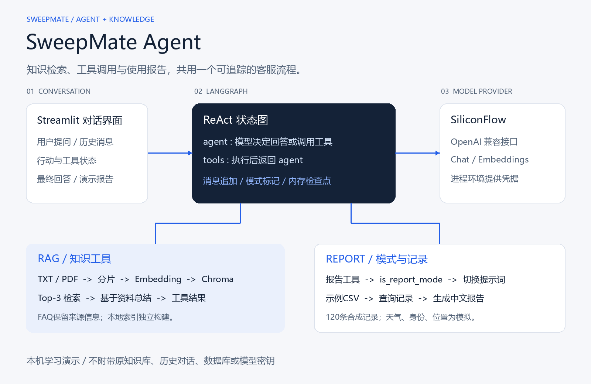

# SweepMate Agent

**面向扫地机器人咨询的 RAG 智能客服：检索知识、调用工具、生成演示使用报告。**

Python 3.11+ / LangGraph / LangChain / Chroma / Streamlit / SiliconFlow

[快速开始](#3-快速开始) | [智能体流程](#4-react-智能体怎样工作) | [RAG实现](#5-知识库如何构建与检索) | [七个工具](#6-工具能力与演示边界) | [报告流程](#7-报告模式如何切换) | [配置](#9-配置与数据位置) | [验证](#11-验证与复现)

SweepMate Agent 把知识问答和工具调用放进同一个对话流程：模型先决定直接回答还是调用工具；工具返回资料或记录后，模型继续生成答案。知识问答通过Chroma检索TXT/PDF资料，报告场景则通过状态标记切换提示词，结合CSV记录生成中文Markdown报告。

这是一个**可以阅读、运行和验证的学习项目**。公开仓库附带两份新编写的示例知识文本与120条合成记录；天气、位置、用户ID和月份工具为固定或随机的演示实现，不连接真实设备或业务系统。原有知识库、用户数据、向量数据库和日志没有作为发布内容。

## 1. 项目解决什么问题

单纯让模型回答产品问题，容易把常识当成具体产品依据；固定问答又难覆盖“查资料、查记录、写报告”等不同流程。本项目将两部分结合：**用RAG补充可检索资料，用显式状态图组织工具与回答的往返。**

| 需求 | 当前实现 | 代码入口 |
| --- | --- | --- |
| 根据资料回答使用问题 | 检索Top-3片段，再经独立模型链总结 | `rag/rag_service.py` |
| 一次回答可能需要多个操作 | agent与tools节点循环，模型自主选择工具 | `agent/react_agent.py` |
| 普通知识和报告写作使用不同指令 | 成功执行报告工具后更新模式标记 | `is_report_mode` |
| 区分行动说明、工具状态和最终回答 | 图节点更新转换为四类前端事件 | `execute_stream()` |
| 维护FAQ与一般说明资料 | 结构检测后选择问答切分或递归切分 | `rag/vector_store.py` |
| 避免每次重复入库 | 文件MD5记录配合本地向量索引 | `load_document()` |
| 不带真实数据也能检查流程 | 合成知识、合成CSV、脚本模型与离线回归 | `data/`、`tests/`、`tools/` |

## 2. 架构与模块分工



[可编辑SVG](docs/assets/sweepmate-flow.svg)与[绘图脚本](tools/generate_architecture.py)一并保留。图片存放在仓库内，README不依赖远程图床或特殊公式渲染。

| 层 | 技术或模块 | 责任 |
| --- | --- | --- |
| 对话界面 | Streamlit | 输入问题、显示历史、展示执行状态和最终回答 |
| 流程编排 | LangGraph StateGraph | 消息追加、条件路由、工具执行、报告标记与内存检查点 |
| 模型适配 | ChatOpenAI / OpenAIEmbeddings | 通过OpenAI兼容接口调用聊天与嵌入模型 |
| 知识服务 | LangChain + Chroma | 文档加载、分片、入库、相似度检索与资料总结 |
| 业务工具 | LangChain tool | 演示天气/身份、CSV记录查询、报告模式入口 |
| 配置与提示词 | YAML + TXT | 分离模型、检索参数、数据路径和三类提示词 |

默认模型接口配置为SiliconFlow。OpenAI在这里指客户端协议与适配类，**不表示请求发往OpenAI服务**；实际请求地址由 `config/rag.yml` 的base_url决定。[SiliconFlow兼容接口说明](https://docs.siliconflow.cn/docs/userguide/quickstart)

## 3. 快速开始

### 3.1 安装依赖

使用Python 3.11或更新版本。本次在Windows、Python 3.13.5的全新虚拟环境验证；没有宣称所有Python小版本与操作系统都已测试。

PowerShell中执行：

```powershell
git clone https://github.com/kayaduster607-jpg/sweepmate-agent.git
cd sweepmate-agent
python -m venv .venv
.\.venv\Scripts\python.exe -m pip install -r requirements.txt
```

### 3.2 先运行无需密钥的固定流程演示

```powershell
.\.venv\Scripts\python.exe -X utf8 tools/offline_demo.py
```

这会运行真实LangGraph与记录查询工具：切换报告模式，读取合成用户1001在2025-01的记录，再输出演示报告。模型响应由脚本预先安排，**不理解任意问题、不调用模型API，也不是联网RAG演示**。它用来检查项目的数据和工具调用链是否能运行。

离线回归也不需要真实密钥：

```powershell
.\.venv\Scripts\python.exe -X utf8 tools/verify.py
```

### 3.3 配置在线模型凭据

在线问答和知识入库需要可用的模型服务凭据。当前客户端使用进程环境变量 `OPENAI_API_KEY`；若base_url是SiliconFlow，这个变量应提供对应服务的Key，变量名称不会决定服务商。

可以在当前PowerShell进程中隐藏输入，不把凭据写入项目文件：

```powershell
$secureKey = Read-Host "Enter the provider API key" -AsSecureString
$env:OPENAI_API_KEY = [System.Net.NetworkCredential]::new("", $secureKey).Password
```

项目不要求创建或加载环境文件。不要把真实Key写入YAML、代码、README、命令样例或提交记录。离线演示使用的 `example` 是无效占位值，不能用于联网调用。

### 3.4 先入库，再启动网页

在同一个已配置凭据的终端中执行：

```powershell
.\.venv\Scripts\python.exe -X utf8 tools/ingest.py
.\.venv\Scripts\python.exe -X utf8 -m streamlit run app.py
```

打开 [http://127.0.0.1:8501](http://127.0.0.1:8501)。入库程序输出本次新增、跳过、失败文件和分片数量；有文件入库失败时退出码为1。网页不会自动替你完成首次知识入库。

入库会调用嵌入模型，在线问答可能同时调用聊天和嵌入模型，按所选服务规则计费。当前默认模型名沿用原始配置：聊天 `Qwen/Qwen2.5-72B-Instruct`，嵌入 `Qwen/Qwen3-Embedding-8B`；本次没有使用真实Key确认这两个模型在你的账号中仍可用，运行前需核对服务端模型列表、工具调用支持与额度。

可以尝试的问题：

- 根据示例知识库，漏扫场景应先检查哪些信息？
- 解释示例耗材状态字段代表什么。
- 为用户1001生成2025-01的合成演示报告。

## 4. ReAct 智能体怎样工作

### 4.1 一个可见的状态循环

```text
START
  -> agent: choose an answer or tool calls
  -> tools: execute selected tools
  -> agent: inspect results and continue
  -> END: answer without further tool calls
```

`AgentState`包含两个字段：

| 字段 | 规则 | 用途 |
| --- | --- | --- |
| `messages` | 使用operator.add追加消息 | 保留用户消息、AI工具请求及ToolMessage结果 |
| `is_report_mode` | 普通布尔状态 | 决定下一轮加载客服提示词还是报告提示词 |

`_call_model()`读取模式，构造一条最新SystemMessage，再拼接非System历史消息，调用已绑定七个工具的模型。`_should_continue()`检查最后一条消息是否有tool_calls；有则进入工具节点，没有则结束。

`_execute_tools()`通过ToolNode执行。工具结果作为ToolMessage进入历史，模型能在下一轮看到结果；发生节点级异常时，代码为待完成的调用补上带相同ID的错误ToolMessage，避免仅返回空消息后留下未回答的工具请求。

### 4.2 事件类型与界面显示

```json
{"type":"thought","content":"Checking the demonstration records."}
```

| 事件 | 产生条件 | 界面位置 |
| --- | --- | --- |
| `thought` | 带工具调用的AI消息中存在行动说明 | 折叠执行区 |
| `log` | 工具节点返回ToolMessage | 折叠执行区，按状态显示成功或失败 |
| `answer` | 不再请求工具的AI消息 | 折叠区外的答案占位符 |
| `error` | 图执行异常被捕获 | 明确显示错误，不追加虚构答案 |

这里的thought是保留的事件名称，表示**模型公开输出的简短行动说明**，不是读取模型内部推理。提示词要求只给行动说明与回答。当前使用 `stream_mode="updates"` 接收节点完成后的更新，模型节点调用的是invoke，因此不把它描述为逐token流式输出。[LangGraph流模式说明](https://docs.langchain.com/oss/python/langgraph/streaming)

### 4.3 会话与循环边界

每个ReactAgent实例有自己的MemorySaver。默认thread_id为 `default_thread`，程序调用者可以显式提供不同thread_id；回归已验证不同线程历史分离。Streamlit将Agent保存在各自的session_state中，但这不等同于已经实现账号认证和持久化用户隔离。

```python
events = agent.execute_stream("Demo question", thread_id="demo-session")
for event in events:
    print(event["type"], event["content"])
```

一次调用从普通模式开始；同一线程的消息仍会保留。检查点只在内存，服务重启后消失。显式图递归上限为25步，它限制图执行步骤，不能当成25次工具调用或固定模型费用上限。[LangGraph检查点说明](https://docs.langchain.com/oss/python/langgraph/persistence)

## 5. 知识库如何构建与检索

### 5.1 入库路径

```text
data/knowledge/*.txt or *.pdf
  -> load documents
  -> check file MD5
  -> detect FAQ or ordinary prose
  -> create chunks with source metadata
  -> request embeddings
  -> persist in local Chroma collection
  -> append successful file hash
```

程序只处理配置目录的直接子文件，不递归扫描下层知识目录。TXT按UTF-8读取；PDF通过PyPDFLoader提取已有文本。当前没有OCR，扫描图片PDF可能没有可用文本，不能由“支持PDF扩展名”推导出“能识别所有扫描件”。

FAQ检测要求同一文本中至少出现5处“行首数字、点、空格”。识别为FAQ后按编号边界切分，保留原文档的source/page元数据；其他文本使用RecursiveCharacterTextSplitter。默认参数如下：

| 项目 | 当前值 | 意义 |
| --- | --- | --- |
| 普通文本chunk_size | `300` | 按字符长度计算，非token数量 |
| 普通文本chunk_overlap | `150` | 相邻普通分片的重叠字符数 |
| 检索k | `3` | 取最多3条相似度结果 |
| collection | `agent` | Chroma集合名称 |
| 本地持久目录 | `chroma_db` | 相对项目根目录解析 |

FAQ按问答结构切分，不额外保证每段小于300字符。配置里的separators默认按普通分隔符处理；其中类似正则的字符串也不会自动成为正则规则，FAQ识别才使用单独的正则表达式。

### 5.2 查询路径

`rag_summarize(query)`先调用retriever取片段，按参考资料编号组合正文和元数据，再把query与context放进RAG提示词，经模型总结后返回字符串。外层Agent读到这个工具结果后，继续组织最终答案。

```text
User question
  -> agent model requests rag_summarize
  -> query embedding + Chroma retrieval
  -> RAG summarization model
  -> ToolMessage
  -> agent model writes the final answer
```

所以常见的一次RAG工具往返可能包含三次聊天模型调用：工具前的决策、RAG内部总结、工具后的回答，另有查询嵌入请求。实际次数取决于工具选择与循环，不能把整轮都算成一次API调用。

嵌入适配设置 `check_embedding_ctx_length=False`，向兼容服务发送文本，避免套用OpenAI专用token编号预处理；这不意味着取消了服务商自己的长度限制。没有实现重排模型、混合检索、相关性阈值或强制逐条引用；提示词中的“只依据资料”也不等于已经证明不会产生幻觉。

### 5.3 去重能做什么，不能做什么

文件向量成功写入后才记录MD5，因此正常重复入库会跳过已处理文件。但Chroma与文本哈希记录不是同一事务：进程崩溃可能留下部分写入。更改文件后会新增分片，当前没有删除旧版本分片；删除文件也不会自动删除旧向量。

如果更换嵌入模型、集合或分片规则，应重建对应索引，并使用匹配的去重记录。只删除数据库而保留旧 `md5.text` 会让程序误以为文件已经入库；只删除哈希记录可能重复加入旧内容。重建前应备份自己需要保留的数据，不要把这两个文件当成互不相关的缓存。

## 6. 工具能力与演示边界

| 工具 | 当前输入与输出 | 实现状态 |
| --- | --- | --- |
| `rag_summarize` | query -> 依据检索资料生成的字符串 | 真实RAG调用链；在线使用需模型服务 |
| `get_weather` | city -> 固定天气文本 | 演示值，非实时天气API |
| `get_user_location` | 无参数 -> 三个预设城市之一 | 随机演示，不是定位 |
| `get_user_id` | 无参数 -> 1001至1010中的一个ID | 随机合成身份，不是登录用户 |
| `get_current_month` | 无参数 -> 2025年的一个月份 | 随机演示月份，不是当前日期 |
| `fetch_external_data` | user_id、month -> JSON文本或空字符串 | 读取配置CSV；发布数据均为合成 |
| `fill_context_for_report` | 无参数 -> 标记工具返回值 | 成功后由工具节点设置报告模式 |

这些工具没有设备远程控制能力。报告工具也不会自动给其他工具注入隐藏参数；“获取ID、月份、查记录”等步骤依赖模型遵守提示词，不是一个已经强制验证所有业务顺序的工作流。

## 7. 报告模式如何切换

```text
Report request
  -> keep explicit user ID and month, or choose demo values
  -> call fill_context_for_report
  -> successful ToolMessage sets is_report_mode = true
  -> next agent node loads report_prompt.txt
  -> call fetch_external_data
  -> produce a Markdown demonstration report
```

模式切换发生在图节点逻辑，当前运行路径不依赖一套额外middleware装饰器。节点只在报告工具成功时更新标记；失败不会伪装成已经切换。

CSV字段契约如下，示例中不包含真实用户或设备数据：

```csv
user_id,feature,efficiency,consumables,comparison,month
1001,synthetic usage,synthetic duration,synthetic status,synthetic comparison,2025-01
```

文件通过csv.DictReader解析，带引号的逗号不会被误拆列；缺少必需字段会报告错误。首次查询将记录读入内存缓存，因此修改CSV后应重启应用。重复的同用户同月份记录以文件中后出现的条目为准。

发布示例覆盖10个合成ID与2025年的12个月，共120条记录，确保演示工具的随机组合能查到示例。数据只包含特征、效率、耗材和对比字符串，没有真实清扫轨迹、传感器数据或身份信息。

## 8. 提示词怎样组织

| 模板 | 用途 | 输入 |
| --- | --- | --- |
| `main_prompt.txt` | 普通客服、工具说明和演示边界 | 作为系统消息与历史一起发送 |
| `rag_summarize.txt` | 根据参考资料总结问题 | `input`、`context` |
| `report_prompt.txt` | 使用记录的报告组织方式 | 从历史与工具结果读取数据 |

客服和报告模板在相应模型节点加载，RAG模板在RAG服务构造时加载；修改RAG模板后应重启服务。公开版本明确区分合成与真实信息，保留“资料不足时说明”的要求。它没有将提示词当成身份认证或数据访问控制。

## 9. 配置与数据位置

| 文件或位置 | 内容 | 是否进入仓库 |
| --- | --- | --- |
| `config/rag.yml` | base_url、聊天和嵌入模型名 | 是，不含Key |
| `config/chroma.yml` | 分片、k、集合、持久目录与去重路径 | 是 |
| `config/agent.yml` | CSV数据路径 | 是，默认指向合成示例 |
| `config/prompts.yml` | 三类提示词路径 | 是 |
| `data/knowledge/demo_*.txt` | 新编写的两份示例知识 | 是 |
| `data/external/records.example.csv` | 120条合成记录 | 是 |
| `chroma_db/`、`md5.text` | 本机生成的索引与去重状态 | 否 |
| `logs/` | 按日期保存的日志 | 否 |
| `.streamlit/config.toml` | 127.0.0.1:8501与关闭使用统计 | 是 |

配置在模块导入时读取，修改模型或路径后应重启应用。默认日志不再打印完整RAG提示词，但异常日志仍可能包含上下文或路径，公开故障材料前需要脱敏。

## 10. 常见问题

| 表现 | 优先检查 |
| --- | --- |
| 启动提示缺少API Key | 在启动该应用的同一终端设置OPENAI_API_KEY；离线验证无需真实Key |
| Key有值但模型返回401或403 | Key是否属于base_url对应服务，账号权限是否正常 |
| 模型返回404或不支持工具调用 | 核对服务商模型ID与tool calling支持，不只检查客户端包版本 |
| 资料检索为空 | 是否先运行入库，知识目录是否含可提取文本，索引与哈希记录是否匹配 |
| PDF没内容 | 扫描件可能需要另做OCR，当前加载器不提供该能力 |
| 改嵌入模型后出现维度错误 | 新旧索引维度可能不同，需要一致地重建集合与去重状态 |
| 报告的身份或月份看起来随机 | 当前默认工具本来就是演示；明确提供ID和月份，或接入自己的认证与日期服务 |
| 网页历史重启后消失 | MemorySaver与Streamlit session_state都不提供长期会话存储 |
| 调用多次工具后报递归限制 | 检查工具是否连续失败、模型是否满足退出条件；不要仅盲目调大上限 |
| Windows终端中文显示异常 | 使用示例中的 `-X utf8`；文件和README按UTF-8保存 |

当前按可信本机学习环境运行，没有账号鉴权、知识访问权限、配额、限流或生产审计系统。共享部署前需要单独设计这些能力，并评估检索内容发送给模型服务的范围。

## 11. 验证与复现

日期：2026-10-25。全新安装requirements后，依赖一致性检查通过，19项回归全部通过：

| 范围 | 已验证内容 |
| --- | --- |
| 真实LangGraph | 直接回答、工具循环、成功/失败报告切换、线程历史分离、模型异常事件 |
| 真实Chroma | 使用假嵌入入库、MD5跳过、Top-3检索和来源元数据 |
| RAG组合 | 提问、片段与元数据进入总结提示词 |
| CSV工具 | 120条记录覆盖、引号逗号、字段缺失、空查询与JSON文本 |
| Streamlit AppTest | 对话输入、最终答案写入历史、错误显示且不伪造答案 |

验证入口在导入应用前拒绝环境文件访问和Python外网连接，模型使用脚本替身，嵌入使用确定性假向量。没有调用真实聊天或嵌入API，没有使用原知识库、业务数据或既有向量数据库。

这些检查证明本地组件与状态流程能连接起来，**不等于回答准确率评测、真实模型联调或完整依赖漏洞审计**。没有编造命中率、延迟提升或成本下降。详细环境、改动与边界见[验证记录](docs/verification.md)和[机器可读结果](docs/verification.json)。

## 12. 代码导航与后续维护

| 路径 | 主要职责 |
| --- | --- |
| [app.py](app.py) | Streamlit页面和前端事件展示 |
| [agent/react_agent.py](agent/react_agent.py) | 状态图、工具分支、模式切换与事件转换 |
| [agent/tools/agent_tools.py](agent/tools/agent_tools.py) | 七个工具、CSV解析和记录缓存 |
| [rag/vector_store.py](rag/vector_store.py) | 入库、FAQ检测、递归分片、MD5与检索器 |
| [rag/rag_service.py](rag/rag_service.py) | 参考资料拼接和总结链 |
| [model/factory.py](model/factory.py) | 聊天及嵌入模型客户端 |
| [utils/config_handler.py](utils/config_handler.py) | YAML配置加载 |
| [tools/ingest.py](tools/ingest.py) | 知识入库入口与结果统计 |
| [tools/offline_demo.py](tools/offline_demo.py) | 无密钥的固定报告流程演示 |
| [tools/verify.py](tools/verify.py) | 离线验证和环境文件访问保护 |
| [NOTICE.md](NOTICE.md) | 来源与第三方依赖说明 |

适合下一步补充的内容包括真实业务适配器、可评测的问答集、证据引用、旧分片更新与删除、持久化会话、工具调用预算和用户隔离。接入真实数据前，应先替换模拟身份工具并建立访问控制，而不只是更换一份CSV。
